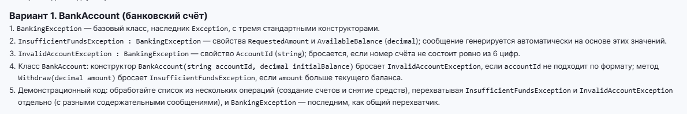
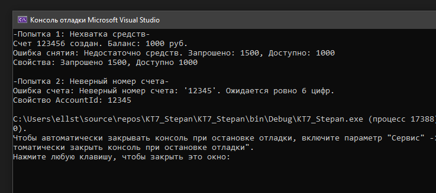

# КТ №7 - Пользовательские исключения (Вариант 1: BankAccount)

Вариант 1

Ключи:
1. Иерархия исключений (наследование от `Exception`).
2. Три стандартных конструктора у каждого класса исключения.
3. Базовое `BankingException` и производные `InsufficientFundsException`, `InvalidAccountException`.
4. Порядок перехвата `catch` (от дочерних к базовому).
5. Использование инициализатора свойств при выбросе исключения.

## Задание:

## Результат работы:
